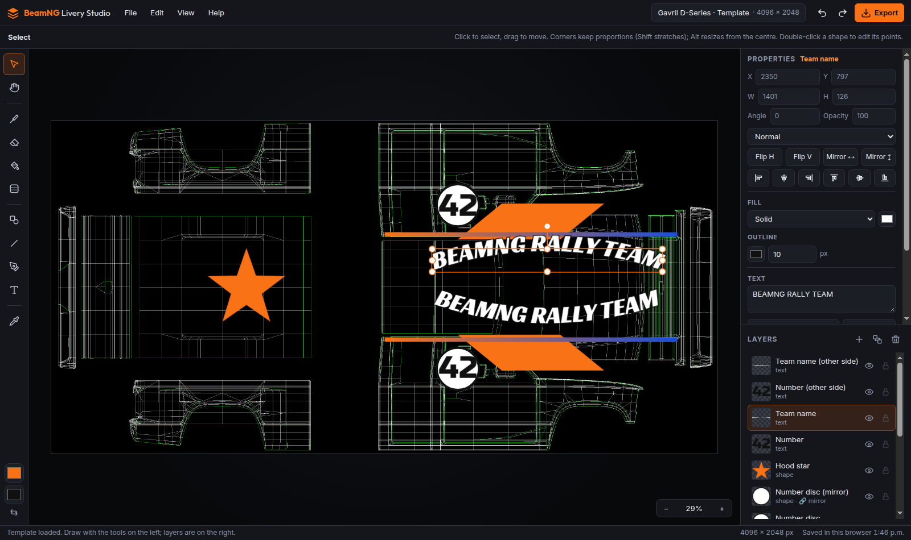

<h1 align="center">BeamNG Livery Studio</h1>

<p align="center"><i>Design vehicle skins for BeamNG.drive in your browser: shapes, curved text, brushes and gradients in layers on the car's own UV template</i></p>

<p align="center">
  
  
  
</p>

<p align="center">
  <a href="https://eagle10021.github.io/BeamNG-Livery-Maker/"><b>Open the studio</b></a> ·
  <a href="#features"><b>Features</b></a> ·
  <a href="#getting-started"><b>Getting Started</b></a> ·
  <a href="#templates"><b>Templates</b></a> ·
  <a href="#putting-it-in-the-game"><b>In the Game</b></a> ·
  <a href="#development"><b>Development</b></a>
</p>

<p align="center">
  
</p>

## Features

- **Real editing tools.** Built on [Fabric.js](https://fabricjs.com/): select, move, resize and rotate with proper handles, multi-select, group, align to the template, snap to its centre and edges, and nudge with the arrow keys.
- **Shapes and paths.** 28 shapes, drawn by dragging, plus a pen tool for your own curves. Double-click any shape or path to move its points.
- **Text.** Racing and display fonts, outline, letter spacing, and a Curve slider that bends text along an arc.
- **Paint.** Brushes (smooth, spray, dots) with size, opacity and softness, an eraser, a fill bucket that fills panels between the template's lines, and an eyedropper.
- **Gradients.** Linear and radial, as a fill on any shape or text, or dragged straight across the texture.
- **Linked mirrors.** A copy on the other side of the car that follows every move and change, so both sides stay matched.
- **Layers.** Thumbnails, show/hide, lock, rename, drag to reorder, blend modes, opacity, and Rasterize to Tattoo: turn any layer into a picture and recolour it with hue, saturation, brightness and tint.
- **Templates from your game.** Open any vehicle's `.zip` from your BeamNG install and use the game's own UV templates and existing skins, new vehicles included.
- **DDS in and out.** Opens BC1 to BC5 and **BC7** textures directly (the format most current BeamNG skins use), and exports uncompressed DDS or PNG at the skin's real size.
- **Your work is kept.** Autosave in the browser, undo/redo, and projects saved as `.livery.json` files you can reopen or share.

## Getting Started

1. Open the studio: **[eagle10021.github.io/BeamNG-Livery-Maker](https://eagle10021.github.io/BeamNG-Livery-Maker/)**. It works in any current browser (Chrome or Edge recommended).
2. Pick a template: **File › Choose template**, or **Open from your BeamNG install** (see below).
3. Design the livery with the tools on the left. **Properties** and **Layers** are on the right; press <kbd>?</kbd> for every shortcut.
4. **Export** (top right) gives the skin as a `.dds` at the template's size.
5. Put it in a mod: the in-app **[Guide](guide.html)** has the folders and files, step by step.

Images, `.dds` files and saved projects can be dropped straight onto the canvas or pasted.

## Templates

| Source | Covers | How |
| :--- | :--- | :--- |
| **Included** | 40 vehicles (plus 8 variants such as ambulance and box bodies), from the Skin Helper mod by Beamer XD | **File › Choose template** |
| **Your BeamNG install** | Every vehicle in your game, including new ones | **File › Open from your BeamNG install**, then pick the vehicle's `.zip` in `BeamNG.drive/content/vehicles/` |

From your install, the studio lists the game's own UV templates and the vehicle's existing skins. UV templates open at the size of the real skins (often 4096 × 4096); an existing skin opens as a layer you can paint over. The zip is read in your browser and nothing is uploaded. In Chrome and Edge you can choose the whole `vehicles` folder once and pick from a list after that.

## Putting It in the Game

The exported texture goes into a small mod: a folder in `mods/unpacked/` with a jbeam file (adds the skin to the **Paint Design** list) and a material file (puts the texture on the car). The **[Guide](guide.html)** walks through both, using the same format as the game's own skins.

The `.dds` export is lossless and large (64 MB for a 4096 × 4096 skin). BeamNG loads it as it is; to make it about four times smaller, convert it to BC7 with `texconv -f BC7_UNORM_SRGB -m 0 file.dds`, Paint.NET or Photopea.

## Troubleshooting

| Problem | Fix |
| :--- | :--- |
| A template or skin won't open | The studio reads BC1–BC5, BC7 and uncompressed DDS, plus PNG and JPG. HDR formats such as BC6H aren't supported: convert those to PNG in Photopea. |
| The skin doesn't show in game | The skin name in the jbeam, the material's name and the texture path must match exactly. See the Guide's troubleshooting section. |
| Mirrored text reads backwards in game | A linked mirror is an exact mirror image. Use a plain copy (Ctrl+D) for text on the other side instead. |
| Fonts look wrong | Fonts come from Google Fonts, so the studio needs to be online when it opens. |
| Lost work | The studio autosaves in the browser you used; clearing that browser's site data removes it. Save a project file (Ctrl+S) to keep a copy. |

## Development

A static site with no build step: plain HTML, CSS and JavaScript modules.

```bash
git clone https://github.com/Eagle10021/BeamNG-Livery-Maker.git
cd BeamNG-Livery-Maker
npx http-server -c-1 .        # or: python3 -m http.server
```

Then open `http://localhost:8080` (or `:8000` for Python). It has to be served over HTTP; opening `index.html` as a file blocks the modules and the templates.

| Path | What it is |
| :--- | :--- |
| `index.html`, `style.css` | The studio's page and look |
| `js/studio.js` | The editor: document, tools, layers, properties, history, projects, templates, export |
| `js/shapes.js` | The shape library |
| `js/zip.js` | Reads vehicle zips from the game (central directory only, one file at a time) |
| `dds.js` | DDS decoder (BC1–BC5, BC7) and encoder (uncompressed RGBA) |
| `guide.html` | The modding guide |
| `Assets/` | Included templates (`manifest.json` lists them) |
| `vendor/` | [Fabric.js](https://github.com/fabricjs/fabric.js) 7.4.0 and [@erase2d/fabric](https://github.com/ShaMan123/erase2d) 1.2.2, both MIT, with their licences |

The BC7 partition tables come from [bcdec](https://github.com/iOrange/bcdec) (MIT / Unlicense).

See [CHANGELOG.md](CHANGELOG.md) for what changed in each version.

---

*Created by Eagle. BeamNG.drive is a trademark of BeamNG GmbH; this is an unofficial fan tool. The included templates are from the Skin Helper mod by Beamer XD.*
